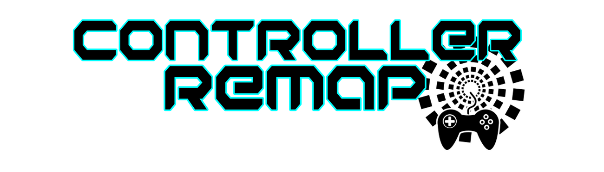
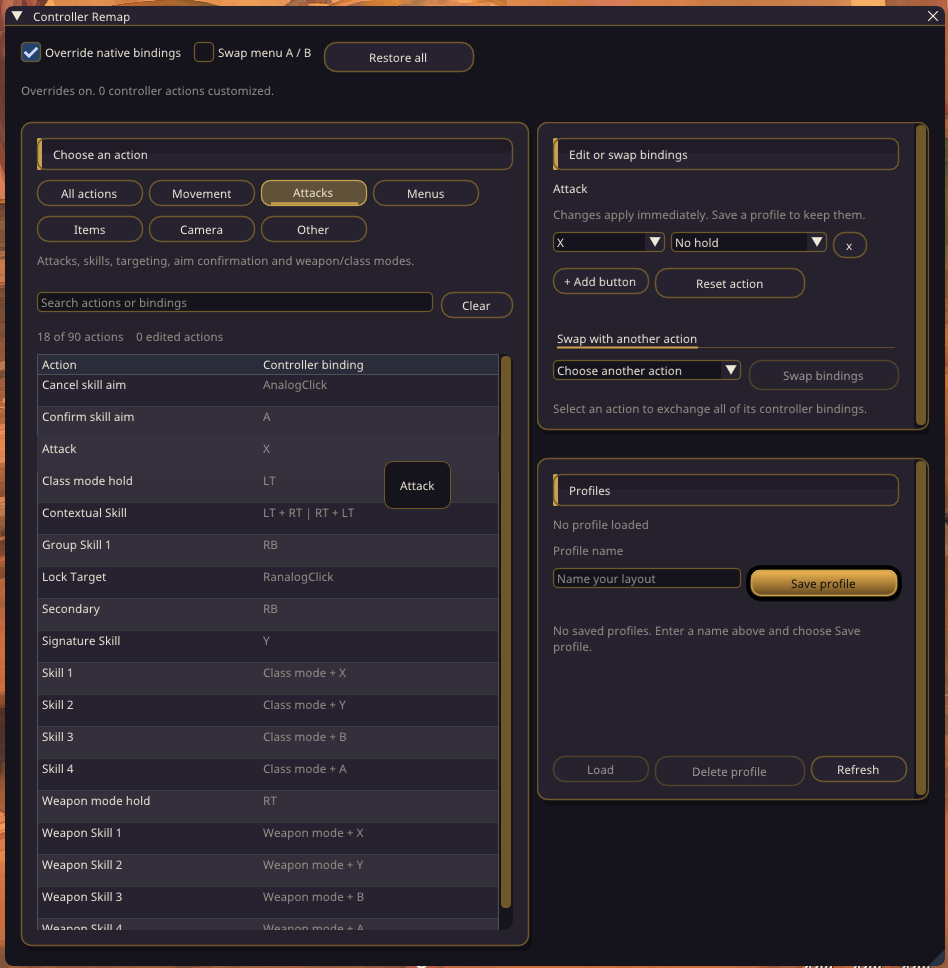
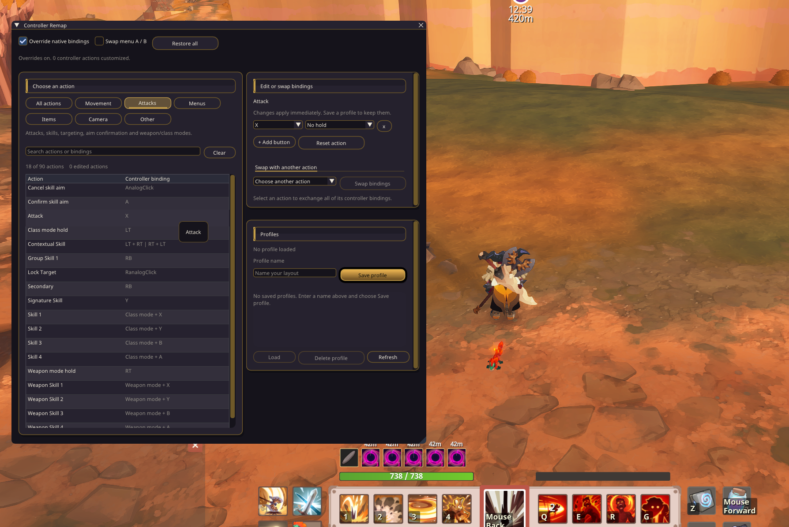
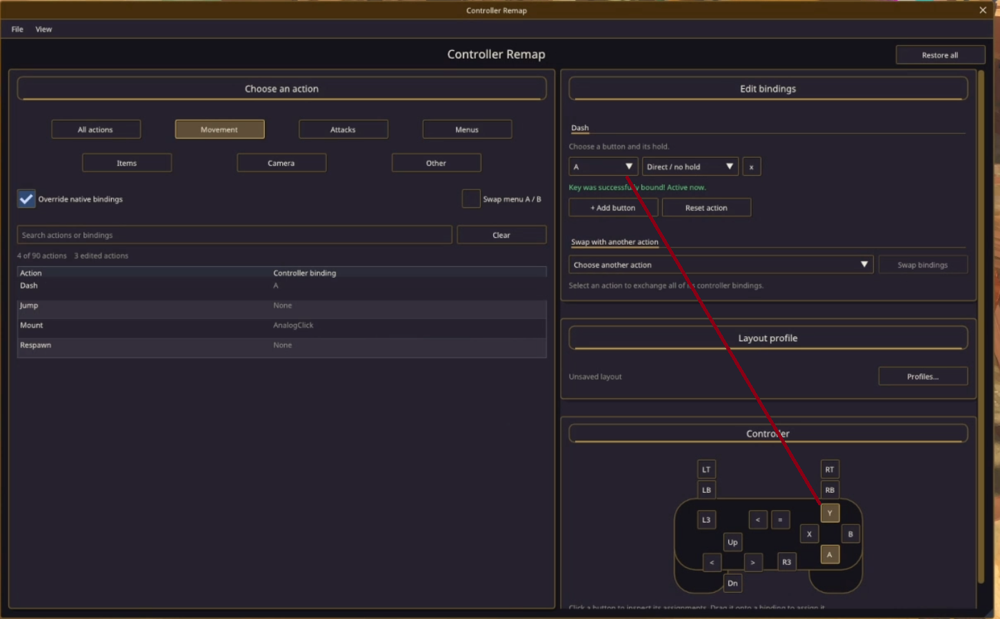
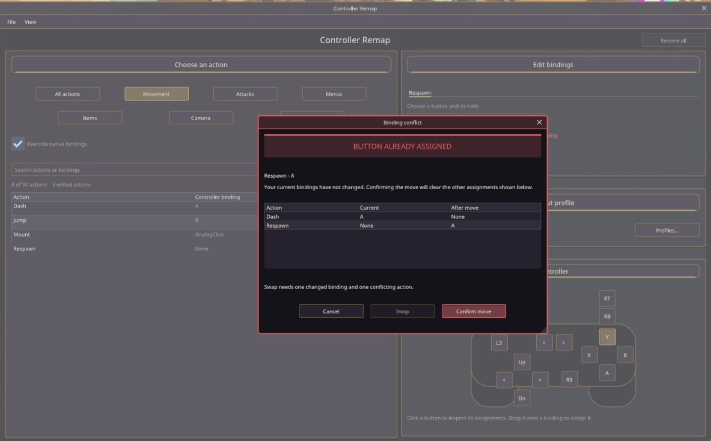

# ControllerRemap 0.3.1

Custom controller layouts for Farever, designed for accessibility.
A standalone HLX mod; SolarFlare is not required.

- Remap buttons, LB/RB/LT/RT combinations and weapon/class mode holds.
- Review overlapping bindings in a centered red warning dialog, with current and proposed assignments.
- See **Key was successfully bound! Active now.** beside the editor after a successful rebind.
- Right-click actions, button fields and saved profiles for quick actions.
- Open focused **Profiles** and **Button Lookup** panels from View.
- Use uniform square-corner action buttons, larger centered headings and spaced sections.
- Spread action filters across the pane, with override/A-B switches directly above the keybind list.
- Click the controller diagram beside the editor to inspect assignments, or drag a button to rebind.
- Save, load, share and delete profiles; toggle overrides and menu/aim A/B swapping.

## Install

1. Install the [HLX Modding Framework](https://github.com/hlx-framework/hlx-core/releases).
2. Close Farever and extract the ControllerRemap ZIP into its game folder, merging `hlx`.
   The SFimgui helper and font are included.
3. Start the game and press **F10**. Open a game menu to free the pointer for editing.

## Bind a button

Choose an action on the left, then its button and optional hold on the right.
A free binding applies immediately. If another action in the same input context uses that exact combination,
a blocking warning dialog shows the current and proposed assignments:

- **Confirm move** assigns the button and clears the conflicting alternatives on other actions.
- **Cancel** keeps the previous layout.
- **Swap** exchanges the old/new bindings when one existing binding conflicts with one other binding.
  When a swap is ambiguous, the editor explains why it is unavailable.

Cancel the dialog to choose a different button or hold. The button, explicit hold
and weapon/class mode must all match to conflict. Different hold combinations
remain independent. Menu/aim/camera controls and raw pad aliases are kept in their own
contexts. Window-opening shortcuts still count as gameplay conflicts. Re-select an
already-shared binding to repair duplicates from an older profile.

**Direct / no hold** uses a plain button. **Remove mode hold** clears inherited
weapon/class modes while keeping any explicit shoulder/trigger hold you chose.
Only the conflicting controller alternatives are cleared; keyboard bindings stay intact.

The success message means the binding is active now. **Save profile** keeps the
layout after restarting the game; it is not needed to activate each rebind.
With overrides off, edits update the layout and the message says they are inactive.

## Find a button

Click a button in the controller diagram below the editor, or open **View > Button lookup panel**.
Hovering a diagram button lists its assignments; the selected action's buttons are highlighted.
The lookup's controller palette and assignments have their own panes.
Click A/B/X/Y, a shoulder/trigger, D-pad or stick button to list every related action,
including modifier and weapon/class mode uses. Expand Stick directions for axes.
Select **Layout** or **Game now** to compare the configured layout with live bindings.
Click a result to edit it, or right-click for its actions. You can also drag a button
from the controller palette onto the button field in the editor; conflicts still require confirmation.

## Profiles

Open **Profiles...** beside the editor, or **View > Profiles panel**.
Enter a name and save. Select a profile row to load/delete, or right-click it for
load, overwrite and delete actions. Confirmations protect unsaved changes and saved
files. **File** also offers Save profile, Refresh profiles and Close window.
Share JSON files from `hlx/mods/controllerremap/profiles/`.

The override switch restores the game's original controller bindings when off.
Restore all resets the current layout; saved files stay available. The A/B switch
only affects menu/aim Confirm and Cancel. Recording remains removed.

## Source

Mod source: `src/controllerremap/`. Exported SolarFlare UI helpers live in
`src/controllerremap/ui/`: ToolWindow, UiChrome, WindowEffects, EnhancedText,
ContextMenuSystem, ImGuiLists, DragDropHelper and supporting palette/scope/color helpers.
They are adapted into this mod, with no SolarFlare runtime dependency. Haxe dependencies
are included in the staged source checkout. On Windows with Haxe 4.3.7, run
`./build.ps1` there to create `build/controllerremap.hl`; `./test.ps1 -HashLink <hl.exe>`
runs the offline regression tests. The native SFimgui renderer is bundled in the ZIP.
The legacy `native/sfpad/` probe source is kept for reference and is not used at runtime.

F10 and returning to camera control close all panels and cancel an unresolved warning.

