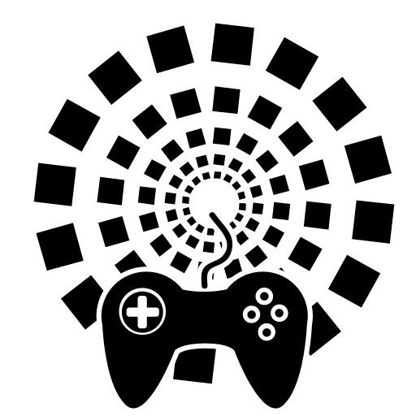

<p align="center"></p>

# ControllerRemap

Custom controller layouts for **Farever**. Made for accessibility, at Narnun's
request for Emuru.

- Remap controller buttons, LB/RB/LT/RT combinations and weapon/class mode holds.
- Swap bindings between actions, including their holds and button alternatives.
- Save, load, share and delete JSON profiles.
- Swap menu/aim Confirm and Cancel on A/B with one switch.
- Turn overrides off to return to the game's bindings, or use Restore all.
- One F10 window, grouped actions and searchable bindings.

## Install

1. Install the [HLX Modding Framework](https://github.com/hlx-framework/hlx-core/releases).
2. Close Farever and extract **dist/ControllerRemap-v0.1.0.zip** into the game folder
   containing `Farever.exe`, merging the `hlx` folder.
3. Start the game and press **F10**. Open a game menu to free the pointer for editing.

The download includes **sfimgui.hdll** and its font. SolarFlare is not required.
`dist/SFimgui-helper.zip` contains the same helper separately.

## Use

Choose a group and action on the left, then edit its button and hold on the right.
Changes apply immediately. To exchange two actions, choose the second under
**Swap with another action** and click **Swap bindings**. Swap again to reverse it.

Enter a name and **Save profile** to keep your layout. Select a saved row to load
or delete it. Overwrite, delete and restore actions ask for confirmation.
Share files from `hlx/mods/controllerremap/profiles/`.

The A/B switch affects menus and aim confirmation only. Keyboard bindings stay as
configured in the game. Overrides remain active while the window is closed;
save your layout before quitting.

## Source

`src/controllerremap/` contains the mod; `src/simplelfg/ui/` contains the shared
UI helpers it uses. Build on Windows with **Haxe 4.3.7** using `./build.ps1`.
The needed Haxe dependencies are included in `deps/`; output is
`build/controllerremap.hl`. The prebuilt native renderer is in the download.

`native/sfpad/` preserves the earlier controller-probe source. It is not used by
this release: remapping uses the game's binding tables, and recording is removed.
To build that optional probe with CMake, Visual Studio C++ tools and a HashLink SDK:

```powershell
cmake -S native/sfpad -B build/sfpad -DHASHLINK_DIR="C:/path/to/hashlink-sdk"
cmake --build build/sfpad --config Release
```

This is the first release. The existing remapper was confirmed working; the new
swap controls and UI polish still need broader in-game testing. Feedback on
controller layouts and accessibility is welcome.
